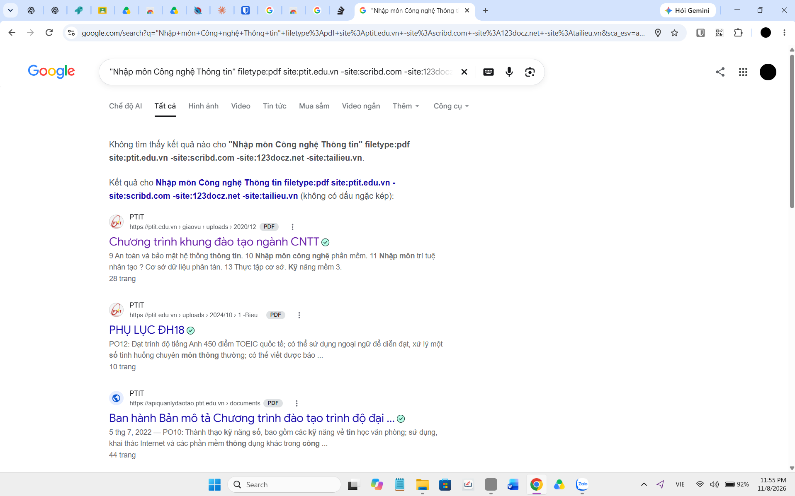

# 1. Chuỗi truy vấn (Query)

"Nhập môn Công nghệ Thông tin" filetype:pdf site:ptit.edu.vn -site:scribd.com -site:123docz.net -site:tailieu.vn

Giải thích từng phần:

"Nhập môn Công nghệ Thông tin": dấu ngoặc kép buộc Google tìm đúng cụm từ này, không tách rời từng chữ.
filetype:pdf: chỉ trả về tệp PDF.
site:ptit.edu.vn: chỉ tìm trên máy chủ của trường (đổi tên miền cho đúng trường của mình).
-site:scribd.com -site:123docz.net -site:tailieu.vn: loại bỏ 3 trang tài liệu hay bắt đăng ký, nạp tiền hoặc đầy quảng cáo.

Lưu ý: vì đã dùng site: nên kết quả vốn chỉ nằm trong tên miền của trường, các toán tử trừ ở đây chủ yếu để đáp ứng yêu cầu bài. Nếu bỏ site: để tìm rộng hơn, các toán tử trừ mới phát huy tác dụng thật sự.

# 2. Tại sao filetype: tiết kiệm thời gian hơn gõ "tải sách..."

Khi gõ "tải sách Nhập môn CNTT", Google trả về đủ loại trang: bài viết quảng cáo, trang đăng ký thành viên, diễn đàn, trang chỉ có nút tải giả. Phải mở từng trang để kiểm tra, vừa mất thời gian vừa dễ dính link độc hại.

Toán tử filetype:pdf ép Google chỉ liệt kê các tệp PDF thật, nên kết quả đầu tiên thường là chính tài liệu cần tìm, mở lên đọc hoặc tải được ngay. Kết hợp với site:, tệp nằm trên máy chủ của trường nên đáng tin cậy và an toàn hơn nhiều.

# 3. Ảnh chụp 3 kết quả đầu tiên

